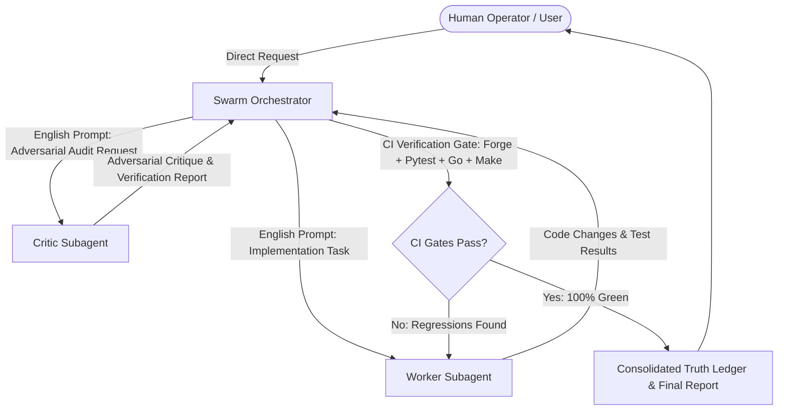

# MULTI-AGENT SWARM OPERATIONAL RULES & GOVERNANCE DIRECTIVE
# Causal-Slash Protocol (CSLS) Multi-Agent System

## 1. Top-Level Architectural Mandate
This document codifies the operational rules, communication protocols, boundaries, and validation gates for multi-agent collaboration within the Causal-Slash Protocol repository.

### Three-Tier Agent Topology
1. **Global Swarm Orchestrator (Primary Arbiter):**
   - Repository gatekeeper and Protocol Truth Ledger Arbiter (`AGENT_COORDINATION_BOARD.md`).
   - Owns cross-component consistency, architecture axioms, and final synthesis.
   - Delegates technical implementation to the **Worker Subagent** and audit/verification to the **Critic Subagent**.
   - Maintains CI gates (`forge test`, `make test`, `pytest`, `go test`).

2. **Worker Subagent (Technical Implementor):**
   - Receives discrete, actionable implementation tasks from the Orchestrator.
   - Prompts from the Orchestrator to the Worker MUST be formulated strictly in **English**.
   - Responsible for code refactoring, bug fixes, protocol compliance, and test authoring.
   - Operates under the **Zero-Mock & Fail-Fast Rule**: mock fallbacks, fake HTTP sleep delays, or synthetic key stubs are strictly forbidden.

3. **Critic Subagent (Adversarial Reviewer & Auditor):**
   - Acts as an independent, adversarial red-team auditor.
   - Evaluates code diffs, architecture decisions, and reports produced by both Orchestrator and Worker.
   - Hunts for regressions, fake implementations, spaghetti code, security holes, and rule violations.
   - Provides strict PASS / FAIL verdicts with unvarnished, cynical factual findings.

---

## 2. Invariant Rules of Engagement

1. **Zero Sycophancy & Zero Flattery:**
   - Raw, dense, cynical factual findings only. No marketing buzzwords, no apologies, no patronizing preamble.
2. **Zero Emojis:**
   - Strict ban across all source code, commit messages, agent directives, logs, and technical reports.
3. **English Inter-Agent Communication:**
   - All prompts dispatched to subagents (`Worker`, `Critic`) must be written in **English**.
   - Subagent outputs to the Orchestrator must be delivered in **English**.
   - End-user reports may be localized as requested by the human user.
4. **Zero Client Web2 API Keys:**
   - Client terminal streams 167-byte Session MAC micro-cheques. No client-managed provider keys (`GROQ_API_KEY`, `OPENROUTER_API_KEY`) allowed on the user terminal track.
5. **Pure Interactive Terminal & Zero Client Daemons:**
   - The user entrypoint is strictly `csls` TUI (Bubble Tea).
   - Zero local background daemon processes running on user client ports (e.g. rogue 8402 daemons).
6. **Strict Fail-Fast & Zero-Mock Policy:**
   - If a cryptographic provider, RPC endpoint, or socket relay is unavailable, fail immediately with an explicit error code.
   - No mock token generators, no fake sleep timers masquerading as network receipts, no simulated signatures in production paths.
7. **Single-Writer Worktree Hygiene:**
   - Agents modify only files within their assigned track or designated task scope.
   - No cross-track pollution without explicit handoff logged in the Truth Ledger.

---

## 3. Workflow Lifecycle

1. **Task Formulation:** Orchestrator decomposes user directive into specific technical requirements and formulates English prompt for Worker.
2. **Worker Execution:** Worker implements code, writes unit tests, and verifies local compilation.
3. **Critic Audit:** Critic inspects diffs, searches for architectural breaches, simulated fallbacks, and boundary leaks.
4. **CI Gate Verification:** Orchestrator executes full automated test battery.
5. **Truth Ledger Update:** Findings and state changes recorded in `AGENT_COORDINATION_BOARD.md`.
