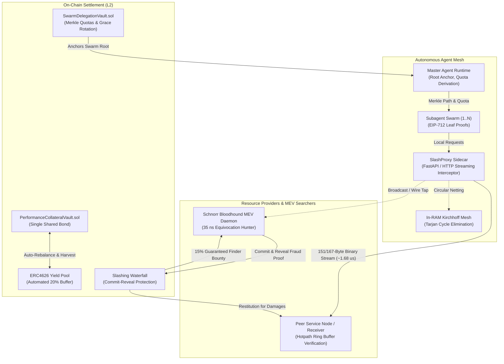

# CSLS — Streaming Micropayments for AI Agents

**Pay-per-request infrastructure for autonomous agents and machine-to-machine services.**

[](LICENSE)
[](tests/)
[](tests/)
[](https://sepolia.basescan.org/address/0x901c98Da847DD24ff23FcC37B6D1549A17F12253#code)
[](https://sepolia.arbiscan.io/address/0x45Cd2B0d1319C158a5B37B74DcBE3D78C9861f1F#code)
[](benchmarks/)

CSLS lets an AI agent pay for APIs, inference, data, compute and other services continuously without submitting an on-chain transaction for every payment.

---

### The Problem

In typical multi-agent architectures, an agent communicating with 50 external service providers (LLM providers, vector databases, web scrapers, compute clouds) must maintain 50 separate prefunded centralized balances:
* **Capital Inefficiency:** $10 deposit x 50 vendors = $500 in locked idle capital to execute cents worth of work.
* **Fragmented Custody:** Funds remain locked in centralized balances with manual top-ups and zero recovery upon vendor downtime.
* **Web2 Barrier:** Autonomous software agents cannot hold human credit cards or pass personal KYC.

---

### How It Works

```text
AI Agent
   │
   │ signed micropayment (167B Session MAC)
   ▼
CSLS Streaming Layer
   │
   ├── Agent-to-Agent Services (Tool Execution, Subagents)
   ├── Data & Oracle Services (Web Search, Scraping, Feeds)
   └── Specialized Service Providers (Inference APIs, Compute Tasks)
   │
   ▼
Settlement on Base / Arbitrum
```

---

### Why CSLS
- **Streaming Payments:** Pay per request or per generated token instead of monthly fixed subscriptions.
- **Zero Gas on the Payment Hot Path:** Payments stream peer-to-peer off-chain and settle residuals in batches on Base L2 or Arbitrum.
- **Collateral-Backed Security:** Participants lock collateral once in a non-custodial vault, removing bilateral counterparty risk.
- **Cryptographic Slashing:** Provable equivocation (double-signing on the same sequence height) triggers automated collateral forfeiture.
- **Agent-Native SDK:** Designed for autonomous agents, supporting Coinbase AgentKit, ElizaOS, and direct Python/Go integrations.

---

### Current Status

| Component | Status | Network / Location |
| :--- | :--- | :--- |
| **Base Sepolia Vault** | Deployed & Verified | [`0x901c98Da847DD24ff23FcC37B6D1549A17F12253`](https://sepolia.basescan.org/address/0x901c98Da847DD24ff23FcC37B6D1549A17F12253#code) |
| **Arbitrum Sepolia Vault** | Deployed & Verified | [`0x45Cd2B0d1319C158a5B37B74DcBE3D78C9861f1F`](https://sepolia.arbiscan.io/address/0x45Cd2B0d1319C158a5B37B74DcBE3D78C9861f1F#code) |
| **Core Clearing Engine** | Active | C11 Native Engine (`src/causal_daemon.c`) |
| **Terminal Client** | Active | Go Bubble Tea TUI (`client/`, binary `csls`) |
| **AgentKit Integration** | Available | [`integrations/agentkit-causal-slash`](integrations/agentkit-causal-slash/) |
| **Python SDK** | Available | [`sdk/`](sdk/) (`causal-slash-sdk`) |
| **Foundry Test Suite** | 82/82 Passing | Unit, Fuzzing, Invariant, and Halmos SMT proofs |
| **Early Access Program** | Open | Cohort #001 (Limited to 25 developer & provider teams) |

> **Early Access:** We are onboarding the first 25 developers and machine-to-machine service providers. See [`docs/roadmap.md`](docs/roadmap.md) for details.

---

## 2. Protocol Architecture & Invariants



### 2.1 Cryptographic Key Derivation & Challenge Formula
Let $\mathbb{G}$ be secp256k1 of prime order $q$ with base generator $G$. An agent locks collateral $B$ in `PerformanceCollateralVault.sol` or `SwarmDelegationVault.sol` and registers public key $PK = sk \cdot G$.

For sequential operational heights $h \in \mathbb{N}$ and counterparty vendor $PK_{\text{vendor}}$:
$$k_h = \text{HMAC-SHA256}(sk, PK_{\text{vendor}} \parallel h) \pmod q$$

To stream a payment cheque for sequence height $h$ binding vendor, height, and cumulative micro-USDC:
$$e_h = \text{SHA256}(PK_{\text{agent}} \parallel PK_{\text{vendor}} \parallel h \parallel \text{cumAmount}) \pmod q$$
$$s_h = (k_h + e_h \cdot sk) \pmod q$$

### 2.2 Optimistic Bounded Credit ($\delta_v$) & Cryptographic Equivocation Slashing
1. **Hotpath Processing:** The vendor accepts incoming cheques within an unconfirmed local credit buffer $\delta_v \le \$1.00$ without blocking on elliptic curve scalar multiplications.
2. **Equivocation Detection:** If an agent signs two distinct cheques $M_1 \neq M_2$ at the identical height $h$:
   $$s_1 = k_h + e_1 \cdot sk \pmod q$$
   $$s_2 = k_h + e_2 \cdot sk \pmod q$$
   $$s_1 - s_2 = (e_1 - e_2) \cdot sk \pmod q$$
3. **Cryptographic Proof of Equivocation:**
   $$sk = (s_1 - s_2) \cdot (e_1 - e_2)^{-1} \pmod q$$
   The mathematical proof of conflicting signatures is submitted on-chain via commit-reveal, making equivocation strictly slashable and foreclosing the offender's collateral bond without exposing honest parties.

### 2.3 Slashing Priority Waterfall
Foreclosed collateral is liquidated according to strict protocol invariants:
1. **15% Guaranteed Finder Bounty:** Paid to the searcher or vendor submitting the valid fraud proof.
2. **Restitution Pool (85%):** Quarantined to compensate honest vendors who suffered exposure.
3. **Residual Surplus Split (60% / 40%):**
   * 60% directed to the Protocol Insurance Reserve.
   * 40% directed to the Protocol Treasury.

## 3. Autonomous MEV Searcher: Schnorr Bloodhound

The protocol includes a high-performance MEV searcher daemon (`src/schnorr_bloodhound.c`) designed for independent arbitrageurs and searchers.

### Mechanics:
* **Microsecond Detection:** Uses a 65,536-entry lock-free hash ring to detect sequence collisions across network streams in ~35 nanoseconds.
* **Frontrunning Mitigation:** Constructs a standard Ethereum Keccak-256 commit-reveal payload (`commitFraudProof` $\to$ `revealAndSlash`), locking the 15% bounty to the searcher's address before revealing the extracted secret key on-chain.

### Building & Running the Bloodhound:
```bash
# Compile and run bloodhound under AddressSanitizer and UndefinedBehaviorSanitizer
make test-bloodhound
```

## 4. SlashProxy: Sidecar Integration

`SlashProxy` (`sdk/slash_proxy.py`) is a local reverse proxy that allows autonomous agent frameworks (including Coinbase AgentKit, ElizaOS, CrewAI, AutoGen, and LangChain) to stream payments per request without modifying core application code.

### Python SDK Installation:
```bash
pip install causal-slash-sdk
```
> **Platform Support:** Linux x86_64 only. The embedded native cryptographic acceleration binaries (`libcausal_slash.so`, `libbloodhound.so`) are compiled specifically for Linux x86_64.

### Integration Flow:
1. Start the proxy sidecar:
   ```bash
   python3 -c "
   from sdk.causal_slash import CausalAgentWallet
   from sdk.slash_proxy import SlashSidecarProxy

   wallet = CausalAgentWallet(agent_private_key=b'\\x77'*32)
   vendor_pk = b'\\x02' + b'\\x33'*32
   proxy = SlashSidecarProxy(wallet, vendor_pk, price_per_request_usdc=0.0005, bind_port=8999)
   proxy.start()
   print('SlashProxy listening on http://127.0.0.1:8999')
   import time; time.sleep(86400)
   "
   ```
2. Direct client requests to `http://127.0.0.1:8999`. The sidecar intercepts completion calls and translates them into streaming 151/167-byte CSLS binary cheques over L4 transport sockets.

## 5. Verified Empirical Benchmarks

Benchmarks executed on x86_64 Linux (AMD Ryzen / Intel Xeon environment):

| Metric | Causal-Slash (L4 Stream) | Direct L2 Tx | Centralized SaaS Billing | Bilateral State Channels |
|---|---|---|---|---|
| **Cryptographic Overhead** | **1.68 µs (Sign + Verify)** | ~1,200 µs (Node ECDSA) | None (API key hash) | ~500 µs (HTLC verification) |
| **Network Latency** | **Direct L4 TCP / QUIC** | RPC roundtrip to Sequencer | HTTPS REST / SSE | Multi-hop onion routing |
| **Intermediate Gas Fee** | **$0.000000 (Zero gas)** | $0.001 - $0.05 per TX | $0.00 (Custodial SaaS) | $0.0002 - $0.001 routing fee |
| **Capital Efficiency** | **1x Shared Bond** | 1x Balance | Nx Fragmented Balances | Nx Locked Liquidity |
| **Unbonding / Exit** | **0 Seconds (Instant)** | Immediate | Manual support request | 24 Hours - 7 Days |
| **Yield Generation** | **ERC4626 Automated Pool** | 0% (Idle balance) | 0% (Vendor balance) | 0% (Channel balance) |

### Industrial Stress Testing Metrics (`benchmarks/`):
* **C11 Stream Daemon (`benchmarks/stress_tcp_swarm.c`):**
  * 1,200,000 cheques processed over raw TCP across 12 concurrent subagents in 4.14 seconds.
  * Sustained throughput: **289,575 cheques/second** (peak 306,340 cheques/second).
  * Latency distribution: Average RTT **13.29 µs**, p50 **12.65 µs**, p99 **24.00 µs**.
  * Memory & Thread Safety: 0 memory leaks under AddressSanitizer (ASan), 0 data races under ThreadSanitizer (TSan).
* **In-RAM Kirchhoff Debt Netting (`sdk/debt_cycle_mesh.py`):**
  * 102,500 mutual obligations across multi-agent graph with gross volume $100,012.50.
  * 12,500 closed debt cycles identified and eliminated in memory via Tarjan SCC.
  * **99.9875% compression ratio** with strict zero balance-drift conservation invariant.

## 6. On-Chain Verification & Test Matrix

The protocol is validated through a comprehensive multi-tier test suite with 100% pass rate:

### 1. Foundry Test Suites (82/82 Passing):
* `tests/PerformanceCollateralVault.t.sol`: 26 unit, state-machine, and fuzzing invariant tests.
* `tests/SwarmDelegationVault.t.sol`: 16 multi-agent delegation, Merkle tree quota, and restitution tests.
* `tests/AdversarialExploits.t.sol`: 23 adversarial exploit tests (signature malleability, replay, self-slashing economics, restitution race, swarm delegation).
* `tests/YieldStreamingCollateral.t.sol`: 4 ERC4626 yield-bearing collateral and liquidity buffer tests.
* `tests/invariants/ProtocolInvariants.t.sol`: 5 comprehensive stateful invariant suites (16,384 calls across runs, 0 reverts).
* `tests/invariants/HalmosProtocolInvariants.t.sol`: 12 formal SMT mathematical theorems proven.

### 2. C Core Memory & Concurrency Audits (ASan, TSan & UBSan):
* `make test`: High-frequency cryptographic engine, equivocation trap, and TCP loopback tests (1.68 µs latency, >500k ops/sec).
* `make test-asan`: Full memory sanitizer check ensuring zero memory leaks or buffer overflows.
* `make test-tsan`: ThreadSanitizer data-race check across multi-threaded agent and refiller threads (0 races).
* `make test-bloodhound`: MEV searcher Keccak-256 vector verification and equivocation extraction test under AddressSanitizer.
* `benchmarks/stress_tcp_swarm.c`: High-load multi-client TCP streaming audit under ASan/TSan.

### 3. Python SDK & Integration Tests (74/74 Passing):
* `pytest -v`: 74 passing tests covering high-speed `ChannelStore`, AsyncIO Actor Queue, secp256k1 honest PK, Circuit Breaker, Edge Guardrails, and On-chain Settlement.
* `tests/test_e2e_full_stack.py`: Full-stack end-to-end integration test suite.

## 7. Repository Structure

```
├── contracts/                                # Solidity Smart Contracts (EVM L2)
│   ├── PerformanceCollateralVault.sol        # Direct Bond Vault, ERC4626 Yield Pool & Slashing
│   ├── SwarmDelegationVault.sol              # Merkle Swarm Delegations, Quotas & Grace Rotation
│   ├── MockERC4626Vault.sol                  # Mock ERC4626 yield-bearing vault for testing
│   └── MockUSDC.sol                          # Mock USDC (6 decimals)
├── src/                                      # C11 Sovereign Engine
│   ├── causal_daemon.c                       # Core cryptographic engine and wire daemon
│   ├── causal_daemon.h                       # Binary framing and C-FFI header
│   ├── csls_daemon.c                         # Standalone streaming daemon binary
│   ├── csls_daemon.h                         # Streaming daemon interface
│   ├── schnorr_bloodhound.c                  # Autonomous MEV searcher engine
│   └── schnorr_bloodhound.h                  # Bloodhound definitions
├── sdk/                                      # Developer SDK & Sidecars
│   ├── ffi.py                                # Low-level C FFI bindings (ctypes)
│   ├── crypto.py                             # secp256k1 EC math, HMAC, KDF & EOTS
│   ├── packet.py                             # Binary wire packet framing (151B / 167B)
│   ├── wallet.py                             # CausalAgentWallet & CausalVendorNode
│   ├── causal_slash.py                       # High-level re-export facade
│   ├── causal_agentkit.py                    # Multi-vendor streaming provider & ActionProvider
│   ├── async_causal.py                       # Asynchronous client channel actor
│   ├── bloodhound.py                         # Python FFI bindings to Bloodhound searcher
│   ├── causal_eth.py                         # Ethereum / L2 settlement helpers
│   ├── channel_store.py                      # Crash-proof monotonic channel store
│   ├── debt_cycle_mesh.py                    # In-RAM Kirchhoff cycle debt netting engine
│   ├── guardrails.py                         # Edge safety inspection & threat mitigation
│   ├── onchain_settler.py                    # On-chain batch settlement & slashing driver
│   ├── slash_proxy.py                        # Reverse proxy sidecar for agent swarms
│   ├── swarm_stream.py                       # Multi-channel swarm streaming
│   ├── swarm_subagent.py                     # Subagent leaf generation & proof handling
│   └── telemetry.py                          # Latency, percentiles and throughput metrics
├── tests/                                    # Comprehensive Test Suites
│   ├── AdversarialExploits.t.sol             # Adversarial exploit test suite
│   ├── PerformanceCollateralVault.t.sol      # Core vault unit and fuzz tests
│   ├── SwarmDelegationVault.t.sol            # Swarm Merkle quotas and grace period tests
│   ├── YieldStreamingCollateral.t.sol        # ERC4626 yield and buffer tests
│   ├── invariants/                           # Invariant & Formal Verification Suites
│   ├── test_causal_agentkit.py               # AgentKit provider tests
│   ├── test_channel_store_and_async.py       # Channel storage and async actor tests
│   ├── test_debt_cycle_stress.py             # Large-scale debt cycle netting stress tests
│   ├── test_e2e_full_stack.py                # Full-stack end-to-end integration tests
│   ├── test_guardrail.py                     # Edge safety guardrail tests
│   ├── test_onchain_settler.py               # EIP-712 and calldata differential tests
│   ├── test_redteam_debt_mesh.py             # Red team debt netting conservation tests
│   ├── test_redteam_sdk_forgery.py           # Signature and session MAC security tests
│   ├── test_sdk_unified.py                   # Unified SDK FFI and streaming tests
│   ├── test_sdk_v3_features.py               # 167-byte MAC wire and session tests
│   └── c/                                    # C Sanitizer & Concurrency Audits
├── benchmarks/                               # Empirical Profiling & Industrial Stress
│   ├── benchmark_e2e_streaming.py            # End-to-end streaming latency benchmark
│   ├── run_kirchhoff_netting.py              # In-RAM Kirchhoff debt netting benchmark
│   ├── slashbench.py                         # High-frequency quantile latency profiler
│   ├── stress_tcp_swarm.c                    # C11 multi-agent 1.2M cheque TCP benchmark
│   └── swarm_onchain_stress.py               # On-chain multi-agent batch stress harness
├── examples/                                 # Executable Quickstarts
│   ├── agentkit_provider_demo.py             # AgentKit provider integration demo
│   ├── elizaos_plugin_demo.py                # ElizaOS agent streaming plugin demo
│   ├── quickstart_agent.py                   # Agent micro-payment quickstart
│   └── quickstart_sidecar.py                 # SlashProxy sidecar quickstart
├── scripts/                                  # Deployment Scripts & Receipts
│   ├── deploy_base_sepolia.js                # Base Sepolia contract deployer
│   ├── deploy_arbitrum_sepolia.js            # Arbitrum Sepolia contract deployer
│   └── deploy_optimism_sepolia.js            # Optimism Sepolia contract deployer
├── Makefile                                  # Build and audit orchestration
├── LICENSE                                   # Dual Licensing Specification (Apache-2.0 / MIT)
└── README.md                                 # Technical Specification
```

## 8. Quickstart & Verification Commands

### 1. Execute EVM Solidity Test Suite:
```bash
forge test -vvv
```
Expected: `Ran 10 test suites: 82 tests passed, 0 failed, 0 skipped (82 total tests)`

### 2. Execute Python SDK Test Suite:
```bash
pytest -v
```
Expected: `74 passed`

### 3. Run C11 Cryptographic Daemon & Socket Benchmarks:
```bash
make test
```
Expected: `Latency per End-to-End Cheque (Sign + Verify): ~1.68 µs`

### 4. Run MEV Schnorr Bloodhound Searcher:
```bash
make test-bloodhound
```
Expected: `All Schnorr Bloodhound Tests Successfully Passed`

### 5. Run High-Frequency Quantile Latency Profiler:
```bash
python3 benchmarks/slashbench.py
```

### 6. Run Autonomous Agent Streaming Quickstart:
```bash
python3 examples/quickstart_agent.py
```

### 7. Sovereign Go Terminal Client (`csls` CLI):
Zero manual gateways, zero local background daemons, zero configuration required. The client works out of the box:
```
Client visits site -> Installs terminal -> Funds bond -> Works like clockwork.
```

Build and install the native Go terminal client:
```bash
make csls-client
csls
```
*(Installs directly to `~/.local/bin/csls` in your `$PATH`. Simply run `csls` from anywhere).*

The terminal shell renders with Charm Bubble Tea & Lip Gloss, featuring persistent input history (`~/.csls/history`), project memory, and live cryptoeconomic settlement:
* `/help` — show command reference table
* `/deposit [amount]` — fund or top up Base L2 collateral bond (5.0 USDC starter bond active by default)
* `/status` — live node status and sovereign upstream routing summary
* `/bond` — query Base L2 collateral bond and free margin
* `/wallet [new|info]` — inspect or create agent wallet (secp256k1 keypair)
* `/model [model_id]` — select or view active frontier models (Claude Opus 5.5, DeepSeek V4.1, GLM 5.3, etc.)
* `/memory` — inspect persistent project conversation context and remembered turns
* `/clear` — reset persistent rolling conversation memory context
* `/vendor` — inspect connected M2M inference routing and public key
* `/hound` — Schnorr Bloodhound equivocation hunter status
* `/net` — in-RAM Kirchhoff debt netting summary
* `/test` — run C11, Foundry, and pytest suites
* `/bench` — latency and throughput benchmark
* `/verify` — on-chain contract addresses and EIP-170 bytecode limits
* `/exit` — quit CSLS shell (or `Ctrl+D` / `Ctrl+C`)

## 9. Deployed & Verified Contracts
 
### Base Sepolia (Chain ID `84532`)
* **SwarmDelegationVault (Hierarchical Merkle Slashing & Settlement):** [`0x901c98Da847DD24ff23FcC37B6D1549A17F12253`](https://sepolia.basescan.org/address/0x901c98Da847DD24ff23FcC37B6D1549A17F12253#code)
  * Bytecode: 24,239 bytes (strictly under the 24,576 byte EIP-170 limit)
  * Status: Verified on Basescan
* **PerformanceCollateralVault (Direct Shared Bond & Optimistic Settlement):** [`0x8faAD06ef5937Ad1019CD49f5Dcab36181e266A5`](https://sepolia.basescan.org/address/0x8faAD06ef5937Ad1019CD49f5Dcab36181e266A5#code)
  * Bytecode: 17,959 bytes
  * Status: Verified on Basescan
* **MockUSDC (Free Mintable 6-Decimals Test Asset for Autonomous Swarms):** [`0xa07eA15D1FE0B884Ffb51b19d98D938b2Bf04D6B`](https://sepolia.basescan.org/address/0xa07eA15D1FE0B884Ffb51b19d98D938b2Bf04D6B#code)
  * Status: Verified on Basescan
 
### Arbitrum Sepolia (Chain ID `421614`)
* **SwarmDelegationVault (Hierarchical Merkle Slashing & Settlement):** [`0x45Cd2B0d1319C158a5B37B74DcBE3D78C9861f1F`](https://sepolia.arbiscan.io/address/0x45Cd2B0d1319C158a5B37B74DcBE3D78C9861f1F#code)
  * Bytecode: 24,239 bytes (strictly under the 24,576 byte EIP-170 limit)
  * Status: Verified on Arbiscan
* **PerformanceCollateralVault (Direct Shared Bond & Optimistic Settlement):** [`0xfEaA1F897FF4540d7B43010A80912FCEcCd95A9a`](https://sepolia.arbiscan.io/address/0xfeaa1f897ff4540d7b43010a80912fceccd95a9a#code)
  * Bytecode: 17,959 bytes
  * Status: Verified on Arbiscan
* **MockUSDC (Free Mintable 6-Decimals Test Asset for Autonomous Swarms):** [`0x8faAD06ef5937Ad1019CD49f5Dcab36181e266A5`](https://sepolia.arbiscan.io/address/0x8faAD06ef5937Ad1019CD49f5Dcab36181e266A5#code)
  * Status: Verified on Arbiscan

## 10. Licensing

Causal-Slash Protocol is dual-licensed under:
* The Apache License, Version 2.0 ([LICENSE-APACHE](http://www.apache.org/licenses/LICENSE-2.0)), or
* The MIT License ([LICENSE-MIT](https://opensource.org/licenses/MIT)),

at your option. See [LICENSE](LICENSE) for full legal text.
