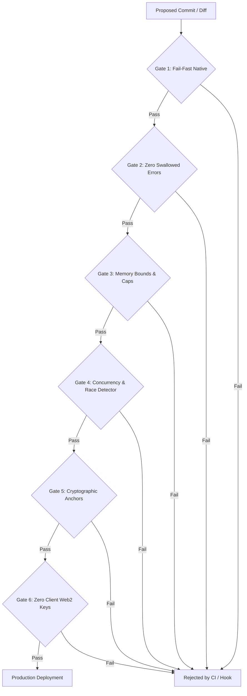

# ENTERPRISE PRODUCTION GATES & ANTI-VIBE-CODING DIRECTIVE
# Causal-Slash Protocol (CSLS) Tier-1 Engineering Standard

## 1. Executive Summary & Purpose
This directive codifies the technical guardrails, automated gates, and architectural bans required for enterprise scale (millions of concurrent agents and users). It explicitly catalogues and outlaws the common failure modes of junior engineers, "vibe-coders", and AI code generators (hallucinations, silent error swallowing, fake mock fallbacks, unanchored mathematical logic).

---

## 2. The 5 Cardinal Anti-Patterns (Hallucinations & Vibe-Coding Traps)

### Trap 1: Unanchored Mathematical Logic & Fake Verification
* **Symptom:** Smart contract or backend accepts an unverified scalar/hash without proving its derivation from a pre-committed state.
* **Historical Exploit in Repo:** `PerformanceCollateralVault.sol:disputeCommitWithNonce` accepted `revealedNonceK` without verifying it against a Merkle root or public point $R = k \cdot G$. Any malicious actor could submit a random scalar $k$, causing `derived != signingAddress`, voiding honest vendor cheques and stealing 1 USDC bonds.
* **Enterprise Rule:** **Zero Unanchored Inputs.** Any mathematical dispute or fraud proof must be cryptographically anchored to an immutable on-chain commitment or Merkle accumulator.

### Trap 2: Protocol Layer Disjointness (Cross-Layer Schema Mismatch)
* **Symptom:** Off-chain layer streams one data format while on-chain smart contracts expect an incompatible legacy standard.
* **Historical Exploit in Repo:** C11 and Go client streamed 167-byte Schnorr EOTS packets, while `SwarmDelegationVault.sol` exclusively demanded 65-byte OpenZeppelin ECDSA signatures (`r, s, v`). Subagent micro-cheques were mathematically impossible to settle on-chain.
* **Enterprise Rule:** **Cross-Layer Fuzz Testing.** Smart contracts and client serialization layouts must share automated end-to-end integration tests in CI.

### Trap 3: Silent Error Swallowing (`_ = err`)
* **Symptom:** Discarding error return values using blank identifiers on disk I/O, wallet generation, or network responses.
* **Historical Exploit in Repo:** `wallet, _ = GenerateNewWallet()`, `_ = SaveWallet(w)`, `_ = m.Save()`. If the disk was full or permissions failed, wallet keys were wiped or never persisted, resulting in silent fund loss.
* **Enterprise Rule:** **Zero Swallowed Errors.** All errors on I/O, cryptographic state, or memory persistence must be explicitly handled or returned up the call stack.

### Trap 4: Synthetic Fallbacks Masquerading as Production Settlement
* **Symptom:** Simulating network responses or cryptographic clearing using local timers (`time.Sleep`), canned token streams, or fake receipts.
* **Historical Exploit in Repo:** `generateSovereignResponse()` using `time.Sleep(12ms)` to stream canned tokens while logging `── $0.0005 USDC settled`.
* **Enterprise Rule:** **Strict Fail-Fast.** If a remote node or blockchain RPC is unavailable, fail immediately with an explicit error code. Mocks and simulations are banned outside designated test files (`*_test.go`).

### Trap 5: Unbounded Resource Growth & Allocation Leaks
* **Symptom:** Data structures growing infinitely in RAM without eviction, TTL, or capacity limits.
* **Historical Exploit in Repo:** 
  1. `m.lines` in TUI growing indefinitely over long interactive chat sessions.
  2. Static `CSLS_MAX_CHANNELS = 1024` table in `causal_daemon.c` without LRU eviction, enabling denial of service.
* **Enterprise Rule:** **Bounded Everything.** All slices, channels, ring buffers, and cache tables must define explicit capacity ceilings (`maxScrollbackLines = 5000`) and deterministic eviction policies.

---

## 3. The 6 Automated Production CI Gates

1. **Gate 1: Fail-Fast Native Binary Enforcement**
   - Python SDK must fail fast if `libcausal_slash.so` is missing. No silent pure-Python mock fallbacks in production paths.
2. **Gate 2: Static Analysis for Swallowed Errors**
   - `golangci-lint` with `errcheck` and `govet` enabled. Commits with `_ = SaveWallet` or discarded file I/O errors fail CI.
3. **Gate 3: Explicit Resource Bounding**
   - All stateful buffers must enforce maximum size guards.
4. **Gate 4: Automated Race Condition Detection**
   - Mandatory `go test -race ./...` on all Go modules.
   - Mandatory `-fsanitize=thread,address,undefined` on all C targets.
5. **Gate 5: Mathematical Anchor Verification**
   - Slither and Foundry invariant testing on all Solidity contracts verifying that no dispute function can be executed without authenticated Merkle proof.
6. **Gate 6: Zero Client Web2 Keys Policy**
   - Automated grep scans blocking client-managed provider keys (`GROQ_API_KEY`, `OPENROUTER_API_KEY`) from production client releases.
